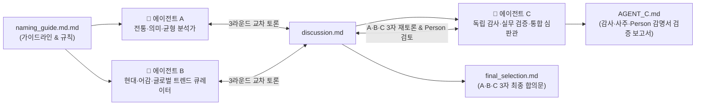

# 👶 여자아이 멀티 에이전트 작명 & 교차 검증 프로젝트 (`naming`)

> **📌 최종 합의 안내 (2026-10-28 업데이트)**: 에이전트 A · B · C의 3자 재토론 및 `Person/` 작명서 검증을 모두 반영한 **최종 3자 공동 합의 결론은 [`final_selection.md`](./final_selection.md)를 기준으로 합니다.** (각 에이전트의 초기 보고서는 토론 과정의 기록으로 보존되어 있습니다.)

2026년 10월 23일 오후 12시 4분에 태어난 여자아이(김씨, 金)의 이름을 선정하기 위해 **3인의 멀티 에이전트(Agent A · B · C)**가 전통 성명학·사주 명리·현대 어감·글로벌 호환성·실무 데이터(인명용 한자 및 출생신고 공개 통계)를 다각도로 토론하고 교차 검증한 프로젝트입니다.

---

## 📋 1. 기본 입력 정보

| 구분 | 정보 | 만세력 명식 (양력 기준) | 핵심 오행·궁합 특징 |
|---|---|---|---|
| **아기** | 여자아이 · 성씨 김(金) 2026년 10월 23일 낮 12시 4분 출생 | **丙午年 戊戌月 庚午日 壬午時** (붉은 말띠 · 경금 일간) | 지지 `午·戌·午·午`의 강한 화(火)·조토(燥土) 열기를 식혀 줄 **1순위 조후용신 `수(水)`**, **2순위 희신 `금(金)`** 보완 필요 |
| **아빠** | 1991년 6월 14일 출생 | **辛未年 甲午月 乙卯日** (하얀 양띠 · 을목 일간) | • 양띠(`未`) ↔ 아기 말띠(`午`) **`오미합(午未合)`** & 일지 `卯` ↔ 아기 월지 `戌` **`묘술합(卯戌合)`** • 아기에게 없는 **`목(木)` 기운(`甲·乙·卯`)을 든든히 보유**, 여름(`午月`)생으로 아기와 함께 **`수(水)` 기운**을 반김 |
| **엄마** | 1991년 12월 4일 출생 | **辛未年 己亥月 戊申日** (하얀 양띠 · 무토 일간) | • 양띠(`未`) ↔ 아기 말띠(`午`) **`오미합(午未合)`** • 아기 사주에 절실한 **`금(申金·辛金)`과 `수(亥水)`의 본원 뿌리(건록)를 완벽히 보유** |
| **최초 후보** | **김지안 · 김지유 · 김시아 · 김지아** | — | 4개 후보 모두 2024~2026년 대법원 여아 출생신고 **TOP 6~12위권** 인기 이름 |

---

## 🤖 2. 멀티 에이전트 역할 및 워크플로우

- **🔹 에이전트 A (Classic & Meaning)**: 한자의 뿌리·훈음, 성씨와의 무게감 및 전통 사주·81수리 균형 분석
- **🔸 에이전트 B (Modern & Trend)**: 일상 호칭의 어감, 받침 흐름, 로마자 표기·글로벌 발음 직관성, 동명이인·트렌드 검토
- **🔺 에이전트 C (Audit, Verification & Final Arbiter)**: A·B 토론 과정과 합의문의 논리적 오류(단일 한자 고정 오류 등), 누락된 부모 사주 궁합, 대법원 인명용 한자 등재 여부 및 원획 수리 대안을 독립 감사하여 최종 확정안 제시

---

## 📂 3. 저장소 문서 구조

| 파일 / 경로 | 작성 주체 | 주요 내용 요약 |
|---|---|---|
| [`naming_guide.md.md`](./naming_guide.md.md) | 프로젝트 가이드 | 기본 제약 사항, 에이전트 A·B·C 역할 정의, 라운드별 토론 프로토콜 및 산출물 규칙 |
| [`AGENT_A/[A]아기_이름_검토_보고서.md`](./AGENT_A/%5BA%5D%EC%95%84%EA%B8%B0_%EC%9D%B4%EB%A6%84_%EA%B2%80%ED%86%A0_%EB%B3%B4%EA%B3%A0%EC%84%9C.md) | 기초 자료 (A) | 9개 후보군의 초기 사주 명식 검토, 원획 수리 계산 및 단계별 점수표 기록 |
| [`discussion.md`](./discussion.md) | 에이전트 A · B · C | Round 1~3(A·B 토론) + 에이전트 C 반론 후 **A·B·C 3자 재토론 및 `Person/` 감명서 검증·최종 서명** 전문 |
| [`final_selection.md`](./final_selection.md) | **에이전트 A · B · C** | **A·B·C 3자 공동 최종 합의문** (**김지유 `金知裕 / 金芝裕`** 대표 추천, `池` 연상 재검토, `Person/` 작명서 해설, 대안 4개 이름 수록) |
| [**`AGENT_C.md`**](./AGENT_C.md) ([`AGENT_C/[C]토론_검증_및_최종_작명_보고서.md`](./AGENT_C/%5BC%5D%ED%86%A0%EB%A1%A0_%EA%B2%80%EC%A6%9D_%EB%B0%8F_%EC%B5%9C%EC%A2%85_%EC%9E%91%EB%AA%85_%EB%B3%B4%EA%B3%A0%EC%84%9C.md)) | **에이전트 C** | **A·B 토론의 7대 오류 감사 + 부모·아기 통합 사주 검증 + `Person/` 외부 작명소 감명서 해독 + 한자 최적화 교정 보고서** |
| [`AGENT_B/`](./AGENT_B) | 에이전트 B | C 반론 재검토, 통계 검증, `Person/` 작명서 및 파동 도식(십성 번호) 재구성 산출물 |
| [`Person/`](./Person) | 외부 작명소 자료 | ‘주원작명소’ 감명서 2장(`金芝裕` 한자 수리·한글 파동성명학 도식) 및 카카오톡 설명 캡처 |

---

## 🔍 4. 에이전트 C의 핵심 감사(Audit) 요약

에이전트 A·B의 토론(`discussion.md`)과 합의문(`final_selection.md`)에서 발견된 주요 문제점과 에이전트 C의 교정 결과입니다.

1. **단일 한자 고정 오류(One-Hanja Lock-in) 해결**:
   - **김지유**: A·B는 뜻이 낯선 중국 강 이름 한자인 `金池洧(물 이름 유)`만 고집했으나, 실제 사전적 본뜻이 **‘너그러울 유(`宥`, 9획)’**인 **`金池宥(8·7·9획)`** 또는 **`金知裕(알 지·넉넉할 유, 8·8·13획)`**를 쓰면 **4격 모두 최상위 대길수(16·15·17·24)**이면서 뜻과 사주(水)가 완벽히 일치합니다.
   - **김지안**: A·B는 `金智安(8·12·6획 → 20·14·26 흉수)` 하나만 보고 수리 충돌이라며 1위에서 제외했으나, 대법원 인명용 한자인 **‘편안할·맑을 안(`晏`, 10획)’**과 **‘연못 지(`池`, 7획)’**를 조합한 **`金池晏(8·7·10획 → 17·15·18·25 4격 모두 길수)`**으로 수리 충돌과 사주 물 보완을 동시에 해결했습니다.
2. **부모(아빠·엄마) 사주와의 통합 궁합 규명**:
   - A·B가 생략한 부모 생년월일을 만세력으로 대조하여, 부모 모두 양띠(`辛未`)로서 말띠(`丙午`) 아기와 **`오미합(午未合)`**을 이루고 엄마(`己亥月 戊申日`)의 금·수 뿌리와 아빠(`甲午月 乙卯日`)의 목 기운이 아기 사주의 공백을 메워준다는 점을 입증했습니다.
3. **대법원 인명용 한자 등재 및 출생신고 통계 실증**:
   - A·B가 ‘미확인’으로 남긴 모든 후보 한자의 **대법원 인명용 한자 정식 등재 여부**와 **2024~2026년 여아 이름 출생신고 순위**를 확인하여 반영했습니다.

---

## 🏆 5. 최종 추천 이름 한눈에 보기

| 추천 구분 | 이름 | 에이전트 C 확정 추천 한자 (훈음) | 원획 (성·상·하) | 81수리 4격 (원·형·이·정) | 핵심 추천 사유 |
|---|---|---|---|---|---|
| **🥇 종합 1위 (One-Pick)** | **김지유** | **① 金知裕** (알 지 · 넉넉할 유, *공동 대표*) **② 金芝裕** (지초 지 · 넉넉할 유, *작명소안*) **③ 金池宥** (연못 지 · 너그러울 유, *연못 선호 대안*) | **8·8·13** **8·10·13** *(8·7·9)* | **21·16·21·29 (4격 길)** **23·18·21·31 (4격 길)** *(16·15·17·24)* | 부드러운 호칭(`지유야`) + **① `知裕`**: ‘고인 물(`池`)’ 연상 없이 앎·넉넉함 직관 전달 / **② `芝裕`**: 작명소안(31획 융창격) / **③ `池宥`**: 물·너그러움 선호 시 |
| **🥈 사주·소리 2위 (간결성 선호)** | **김지아** | **金池娥** (연못 지 · 예쁠 아) *또는* **金池芽** / **金沚兒** | **8·7·10** *(8·8·8)* | **17·15·18·25 (4격 대길)** *(16·16·16·24)* | 첫 글자 물(`池/沚`)로 사주 열기 제어 + 가장 짧고 열린 어감 및 직관적인 영문 표기(`Jia`) |
| **🥉 문학적·맑은 이미지 선호** | **김시아** | **金詩娥** (시 시 · 예쁠 아) *또는* **金詩芽** (시 시 · 싹 아) | **8·13·10** | **23·21·18·31 (4격 길)** | 경쾌하고 세련된 울림(`Sia`)과 금(`詩`) 보완 (단, 직접적인 물 `氵` 한자 배합은 어려움) |
| **⚠️ 받침·뜻 선호 (사주 차선)** | **김지안** | **金池晏** (연못 지 · 편안할 안) *또는* **金池岸** (연못 지 · 언덕 안) | **8·7·10** *(8·7·8)* | **17·15·18·25 (4격 대길)** *(15·15·16·23)* | `金智安`의 수리 흉수는 `池晏`으로 해결되나, `晏`에 `日(화 火)` 부수가 있어 사주 화(火) 배제 면에서는 `지유·지윤·지아`가 우위 |
| **💎 추가 추천 ① (스테디셀러)** | **김지윤** | **金知潤** (알 지 · 윤택할 윤) *또는* **金池潤** (연못 지 · 윤택할 윤) | **8·8·16** *(8·7·16)* | **24·16·24·32 (4격 대길)** *(23·15·24·31)* | 지혜(`知`, 금)와 윤택함(`潤`, 수)의 **금생수(金生水)** 조화 + 최초 4후보보다 동명이인 비율이 낮아 희소성 우수 |
| **🌊 추가 추천 ② (발음오행 상생)** | **김하윤** | **金河潤** (물 하 · 윤택할 윤) | **8·9·16** | **25·17·24·33 (4격 대길)** | 한글 음오행 흐름이 매우 부드럽고 두 글자 모두 큰 물(`河·潤`)을 담아 사주 조후 보완력이 탁월함 |
| **✨ 추가 추천 ③ (트렌디/순우리말)** | **김이서 / 김윤슬** | **金伊緖** / **순우리말(윤슬)** | — | — | 세련된 모음 연결(`이서`) 또는 아기 사주의 ‘태양(`丙午`) 아래 반짝이는 물결(`壬水`)’을 담은 순우리말(`윤슬`) |

---

## 📄 라이선스

이 저장소는 [Apache License 2.0](./LICENSE)을 따릅니다.
