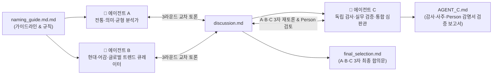

# 👶 여자아이 멀티 에이전트 작명 & 교차 검증 프로젝트 (`naming`)

> **📌 최종 합의 안내 (2026-10-28 업데이트)**: 에이전트 A · B · C의 3자 재토론 및 `Person/` 작명서 검증을 모두 반영한 **최종 3자 공동 합의 결론은 [`final_selection.md`](./final_selection.md)를 기준으로 합니다.** (각 에이전트의 초기 보고서는 토론 과정의 기록으로 보존되어 있습니다.)

2026년 10월 23일 오후 12시 4분에 태어난 여자아이(김씨, 金)의 이름을 선정하기 위해 **3인의 멀티 에이전트(Agent A · B · C)**가 전통 성명학·사주 명리·현대 어감·글로벌 호환성·실무 데이터(인명용 한자 및 출생신고 공개 통계)를 다각도로 토론하고 교차 검증한 프로젝트입니다.

---

## 📋 1. 기본 입력 정보

| 구분 | 정보 | 만세력 명식 (양력 기준) | 참고 특징 요약 |
|---|---|---|---|
| **아기** | 여자아이 · 성씨 김(金) 2026년 10월 23일 낮 12시 4분 출생 | **丙午年 戊戌月 庚午日 壬午時** (붉은 말띠 · 경금 일간) | • **겉글자 오행 집계(`목0·화4·토2·금1·수1`)**: 단순 개수는 `목(0개)`이 가장 적어 식물 상징(`芝`)과 연결해 볼 수 있음(조건부 가설, 실제 작명가 방식 미확정) • **조후·균형 관점**: 불(`火` 4개)·건조함을 완화하는 관점에서는 불을 돕는 `목`보다 물(`수 水: 池·潤`)의 상징을 우선 참고할 수 있음 |
| **아빠** | 1991년 6월 14일 출생 | **辛未年 甲午月 乙卯日** (하얀 양띠 · 을목 일간) | 전통 명리에서 부모의 `未`와 아이의 `午`를 육합 관계로 읽는 방식이 있음(출생 시각이 없어 가족 궁합이나 이름 우열 점수로 확정하지 않음) |
| **엄마** | 1991년 12월 4일 출생 | **辛未年 己亥月 戊申日** (하얀 양띠 · 무토 일간) | 전통 명리에서 부모의 `未`와 아이의 `午`를 육합 관계로 읽는 방식이 있음(부모 글자를 아이 오행 개수에 합산하지 않음) |
| **최초 후보** | **김지안 · 김지유 · 김시아 · 김지아** | — | 4개 후보 모두 2025년 공개 재게시 통계 기준 여아 **7~12위권** 대중적 이름 |

---

## 🤖 2. 멀티 에이전트 역할 및 워크플로우

- **🔹 에이전트 A (Classic & Meaning)**: 한자의 뿌리·훈음, 성씨와의 무게감 및 전통 사주·81수리 균형 분석
- **🔸 에이전트 B (Modern & Trend)**: 일상 호칭의 어감, 받침 흐름, 로마자 표기·글로벌 발음 직관성, 동명이인·트렌드 검토
- **🔺 에이전트 C (Audit, Verification & Final Arbiter)**: A·B 토론 과정과 합의문의 논리적 오류(단일 한자 고정 오류 등), 누락된 부모 사주 궁합, 대법원 인명용 한자 등재 여부 및 원획 수리 대안을 독립 감사하여 최종 확정안 제시

---

## 📂 3. 저장소 문서 구조

| 파일 / 경로 | 작성 주체 | 주요 내용 요약 |
|---|---|---|
| [`naming_guide.md.md`](./naming_guide.md.md) | 프로젝트 가이드 | 기본 제약 사항, 에이전트 A·B·C 역할 정의, 라운드별 토론 프로토콜 및 산출물 규칙 |
| [`AGENT_A/[A]아기_이름_검토_보고서.md`](./AGENT_A/%5BA%5D%EC%95%84%EA%B8%B0_%EC%9D%B4%EB%A6%84_%EA%B2%80%ED%86%A0_%EB%B3%B4%EA%B3%A0%EC%84%9C.md) | 기초 자료 (A) | 9개 후보군의 초기 사주 명식 검토, 원획 수리 계산 및 단계별 점수표 기록 |
| [`discussion.md`](./discussion.md) | 에이전트 A · B · C | Round 1~3(A·B 토론) + 에이전트 C 반론 후 **A·B·C 3자 재토론 및 `Person/` 감명서 검증·최종 서명** 전문 |
| [`final_selection.md`](./final_selection.md) | **에이전트 A · B · C** | **A·B·C 3자 공동 최종 합의문** (**김지유 `金知裕 / 金芝裕`** 대표 추천, `池` 연상 재검토, `Person/` 작명서 해설, 대안 4개 이름 수록) |
| [**`AGENT_C.md`**](./AGENT_C.md) ([`AGENT_C/[C]토론_검증_및_최종_작명_보고서.md`](./AGENT_C/%5BC%5D%ED%86%A0%EB%A1%A0_%EA%B2%80%EC%A6%9D_%EB%B0%8F_%EC%B5%9C%EC%A2%85_%EC%9E%91%EB%AA%85_%EB%B3%B4%EA%B3%A0%EC%84%9C.md)) | **에이전트 C** | **A·B 토론의 7대 오류 감사 + 부모·아기 통합 사주 검증 + `Person/` 외부 작명소 감명서 해독 + 한자 최적화 교정 보고서** |
| [`AGENT_B/`](./AGENT_B) | 에이전트 B | C 반론 재검토, 통계 검증, `Person/` 작명서 및 파동 도식(십성 번호) 재구성 산출물 |
| [`Person/`](./Person) | 외부 작명소 자료 | ‘주원작명소’ 감명서 2장(`金芝裕` 한자 수리·한글 파동성명학 도식) 및 카카오톡 설명 캡처 |

---

## 🔍 4. 에이전트 C의 핵심 감사(Audit) 및 3자 교차 검증 요약

에이전트 A·B·C가 토론(`discussion.md`)과 합의문(`final_selection.md`)에서 교차 검증해 확장·정리한 핵심 사항입니다.

1. **단일 한자 고정 오류(One-Hanja Lock-in) 해소 및 대안 확장**:
   - **김지유**: 초기 비교안이었던 `金池洧(물 이름 유)`에만 머물지 않고, 뜻이 직접적인 **`金知裕(알 지·넉넉할 유, 8·8·13 → 21·16·21·29)`**, 작명가안인 **`金芝裕(지초 지·넉넉할 유, 8·10·13 → 23·18·21·31)`**, 연못·너그러움의 뜻을 담은 **`金池宥(연못 지·너그러울 유, 8·7·9 → 16·15·17·24)`**로 선택지를 넓혔습니다.
   - **김지안**: `金智安(8·12·6 → 18·20·14·26)`의 수리 한계를 피하고 싶을 때 비교할 수 있는 **`金池晏(연못 지·편안할 안, 8·7·10 → 17·15·18·25)`** 대안을 함께 제시했습니다.
2. **아기 출생일시 및 부모 생년월일 만세력 대조**:
   - 아기 명식(`丙午年 戊戌月 庚午日 壬午時`)과 부모 생일의 만세력 날짜(`辛未年 甲午月 乙卯日`, `辛未年 己亥月 戊申日`)를 대조하고, 전통 해석의 참고 범위와 한계를 구분해 정리했습니다.
3. **인명용 한자 검색 색인 및 공개 재게시 통계 확인**:
   - 후보 한자들의 인명용 한자 검색 색인 대응 여부와 2025년 여아 이름 공개 재게시 통계(7~12위권)를 대조하고, 실제 출생신고 시 확인할 절차([전자가족관계등록시스템](https://efamily.scourt.go.kr/))를 안내했습니다.

---

## 🏆 5. 최종 추천 이름 한눈에 보기 ([`final_selection.md`](./final_selection.md) 기준)

| 역할 구분 | 이름 | 검토 한자 (훈음) | 원획 (성·첫·끝) | 원·형·이·정 (채택 수리표 분류) | 뜻과 선택 이유 요약 |
|---|---|---|---|---|---|
| **종합 추천** | **김지유** | **① 金知裕** (알 지 · 넉넉할 유, *공동 대표*) **② 金芝裕** (지초 지 · 넉넉할 유, *작명소안*) **③ 金池宥** (연못 지 · 너그러울 유, *연못 선호 대안*) | **8·8·13** **8·10·13** *(8·7·9)* | **21·16·21·29 (4격 길수)** **23·18·21·31 (4격 길수)** *(16·15·17·24, 4격 길수)* | 부드러운 호칭(`지유야`) + **① `知裕`**: ‘고인 물(`池`)’ 연상 없이 앎·넉넉함 직접 전달 / **② `芝裕`**: 작명소안(식물 이미지·여유) / **③ `池宥`**: 물 상징·너그러움 선호 시 |
| **새 이름 중 의미 대안** | **김지윤** | **金知潤** (알 지 · 윤택할 윤) *또는* **金池潤** (연못 지 · 윤택할 윤) | **8·8·16** *(8·7·16)* | **24·16·24·32 (4격 길수)** *(23·15·24·31, 4격 길수)* | `池(연못)`를 피하면서 **`潤(윤택할 윤, 氵)`**으로 물의 이미지와 ‘앎·윤택함’의 뜻을 함께 담고 싶을 때 비교할 대안 |
| **소리·간결성 대안** | **김지아** | **金池芽** (연못 지 · 싹 아) *또는* **金池娥** (연못 지 · 예쁠 아) | **8·7·10** | **17·15·18·25 (4격 길수)** | 연못·싹의 성장 이미지 또는 연못·예쁨 + 가장 짧고 열린 어감 및 간결한 영문 표기(`Jia`) |
| **문학적 이미지 대안** | **김시아** | **金詩芽** (시 시 · 싹 아) *또는* **金詩娥** (시 시 · 예쁠 아) | **8·13·10** | **23·21·18·31 (4격 길수)** | 시·싹 또는 시·예쁨의 문학적이고 맑은 인상을 선호할 때의 대안(`Sia`) |
| **지혜·평안 대안** | **김지안** | **金智安** (슬기 지 · 편안할 안) *또는* **金池晏** (연못 지 · 편안할 안) | **8·12·6** *(8·7·10)* | **18·20·14·26** *(17·15·18·25, 4격 길수)* | `智安`은 지혜·평안의 뜻이 직접적이며(기존 수리 길수 조건과는 충돌), 수리 조건을 맞추면 `池晏`(연못·평안) 비교 가능 |
| **추가 소리 범위 후보** | **김지우 · 김하윤 · 김나윤** | *별도 한자 미확정* | — | — | 소리 범위를 넓혀 비교할 때 참고할 추가 후보 |

---

## 📖 6. 원·형·이·정 4격 및 81수리 전통 명칭(`~격 / ~운`) · 길수 분류 해설

한자 성명학에서는 성씨와 이름 한자의 원획을 더한 **4개의 숫자(원격=이름 두 글자, 형격=성+첫 글자, 이격=성+끝 글자, 정격=세 글자 합)**에 각각 **수리표가 붙이는 자료별 전통 명칭(`~격 / ~운`)**과 **길흉 분류(`길·대길` 등)**를 붙여 풀이합니다.
- **‘~격 / ~운(융창격·두령운·덕망격 등)’은 해당 숫자에 붙인 전통 명칭**이고, **‘길·대길’은 길수 분류 표시**입니다. 즉 ‘융창격’과 ‘대길’은 서로 다른 등급이 아니라, **31획의 통상 명칭이 ‘융창격’이고 그 분류가 길수(길·대길) 범주**에 속합니다(자료마다 같은 길수를 `길`로 통일해 적거나 `길·대길`로 나누어 적으며, 서로 다른 표의 표기를 섞어 후보 우열을 매기지 않습니다).
- 네 격에 배당하는 시기 역시 자료마다 다릅니다(예: 아래 참고 출처 1은 `원격=초년운, 형격=중년운, 이격=말년운, 정격=인생총운`으로 적고, 다른 자료는 청장년·중장년 등으로 나누기도 함). 또한 `Person/` 작명서 원본에는 ‘융창격’ 해설이 적혀 있으며, 이는 `金(8)+芝(10)+裕(13)=31`의 정격 수리와 연결되는 것으로 해석됩니다(원본 종이 자체에 네 격 숫자 표가 인쇄되어 있는 것은 아님).

### 1) 참고 수리표([아이이름작명원 81수리표](https://www.iirum.com/iirum/name/sub06.htm/m/include/form/m/order/sub07.htm))에서 확인되는 명칭과 분류 예시

아래 표는 위 단일 출처에서 각 숫자에 붙인 `격 · 운` 명칭과 분류(`吉`)를 확인한 예시입니다(모든 학파의 유일한 표준 명칭이라는 뜻이 아니며, [문경작명소 31획](https://ksaju.com/31)처럼 31획에 `흥성격·융창격·대성운·흥가운` 등 여러 별칭을 병기하는 자료도 있습니다).

| 획수 | 출처 1의 격 명칭 | 출처 1의 운 명칭 | 출처 1의 분류 | 전통 수리 해설의 주요 상징 요약 | 해당 숫자가 포함된 후보 |
|---|---|---|---|---|---|
| **15획** | **통솔격 (統率格)** | **복수운 (福壽運)** | **길 (吉)** | 통솔력과 온화한 화합, 복록과 장수의 상징 | `金池宥` (형격), `金池芽/娥/晏` (형격) |
| **16획** | **덕망격 (德望格)** | **재부운 (財富運)** | **길 (吉)** | 큰 덕(德)과 인망(望), 신뢰와 재복의 상징 | `金池宥` (원격), `金知裕`·`金知潤` (형격) |
| **17획** | **건창격 (健暢格)** | **용진운 (勇進運)** | **길 (吉)** | 굳센 의지와 신념으로 나아가는 진취의 상징 | `金池宥` (이격), `金池芽/娥/晏` (원격) |
| **18획** | **발전격 (發展格)** | **융창운 (隆昌運)** | **길 (吉)** | 지혜와 실행력으로 꾸준히 발전하는 상징 | `金芝裕` (형격), `金池芽/娥/晏`·`金詩芽/娥` (이격) |
| **21획** | **자립격 (自立格)** | **두령운 (頭領運)** | **길 (吉)** | 자립심과 통솔력, 존경과 성취의 상징 | `金知裕` (원격·이격), `金芝裕` (이격), `金詩芽/娥` (형격) |
| **23획** | **공명격 (功名格)** | **융창운 (隆昌運)** | **길 (吉)** | 밝고 힘찬 기운으로 발전·번창하는 상징 | `金芝裕` (원격), `金詩芽/娥` (원격) |
| **24획** | **입신격 (立身格)** | **축재운 (蓄財運)** | **길 (吉)** | 성실한 자수성가와 풍족한 결실·축재의 상징 | **`金池宥` (정격)**, `金知潤` (원격·이격) |
| **25획** | **안강격 (安康格)** | **재록운 (財祿運)** | **길 (吉)** | 탄탄한 기반과 안강(편안·강건)·재록의 상징 | **`金池芽/娥/晏` (정격)** |
| **29획** | **성공격 (成功格)** | **향복운 (享福運)** | **길 (吉)** | 지혜와 재능을 발휘해 성취하고 복을 누리는 상징 | **`金知裕` (정격)** |
| **31획** | **융창격 (隆昌格)** | **흥가운 (興家運)** | **길 (吉)** | 지·인·용을 겸비하여 집안을 일으키고 번창하는 상징 | **`金芝裕` (정격)**, **`金詩芽/娥` (정격)** |
| **32획** | **순풍격 (順風格)** | **왕성운 (旺盛運)** | **길 (吉)** | 순풍을 만난 듯 주변의 도움과 기회를 얻는 상징 | **`金知潤` (정격)** |

### 2) 세 가지 ‘김지유’ 한자 뜻과 전통 수리 설명 비교 및 유의점

| 조합 | 한자에 담는 실제 뜻 | 수리의 전통 설명을 소개한다면 |
|---|---|---|
| **金知裕** | 앎·넉넉함 | 자립·인덕·성취의 상징을 함께 소개할 수 있다. |
| **金芝裕** | 지초·넉넉함 | 발전·번창의 상징을 함께 소개할 수 있다. |
| **金池宥** | 연못·너그러움 | 인덕·복록뿐 아니라 의지·진취의 상징도 함께 소개할 수 있다. |

> 세 조합 모두 이번에 참고한 표에서 길수로 분류됩니다. 풀이의 강조점은 달라도 서로 겹치는 덕담이 많아 ‘리더형 대 안정형’ 같은 배타적 성격 유형이나 필연적 성장 경로로 나누기는 어렵습니다. 이름에 담고 싶은 뜻은 고를 수 있지만, 그 수리 풀이가 아이의 실제 성격이나 삶의 결과, 사주 우열을 정한다는 뜻은 아닙니다(여성이라는 이유로 특정 수를 감점하지도 않습니다).

---

## 📄 라이선스

이 저장소는 [Apache License 2.0](./LICENSE)을 따릅니다.
